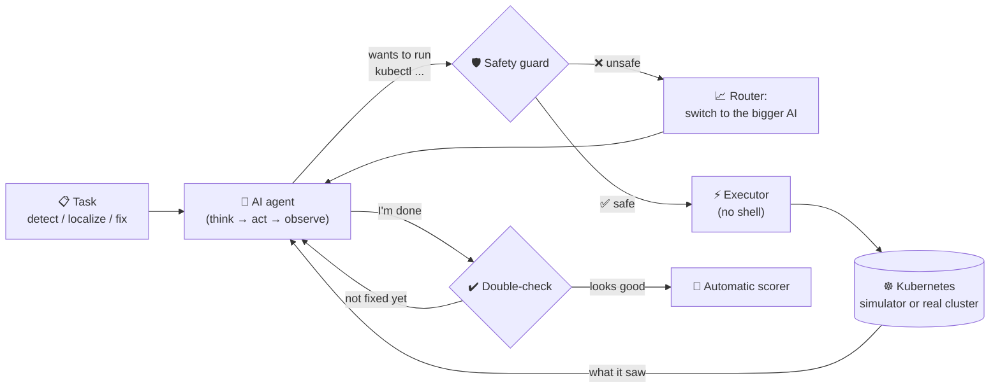
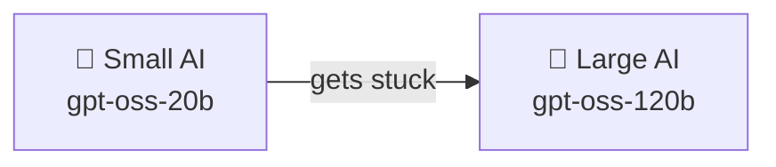

<div align="center">

# 🛠️ OpsPilot

### An AI on-call engineer that finds and fixes broken Kubernetes apps safely, on free AI models

[](https://github.com/Kaushik-verse/opspilot/actions/workflows/ci.yml)


**94% of incidents solved · 69% fewer expensive-model tokens · 0 unsafe commands executed**

</div>

---

## 📖 Table of contents

1. [The story in plain words](#-the-story-in-plain-words)
2. [What OpsPilot does](#-what-opspilot-does)
3. [How it works](#-how-it-works)
4. [The three safety ideas](#-the-three-safety-ideas)
5. [The broken things we test with](#-the-broken-things-we-test-with)
6. [Results](#-results)
7. [Try it yourself](#-try-it-yourself)
8. [Project structure](#-project-structure)
9. [Tech stack](#-tech-stack)
10. [Honest limitations](#-honest-limitations)
11. [What's next](#-whats-next)

---

## 🧒 The story in plain words

Imagine a big online **hotel-booking website**. It isn't one program. It's **14 little programs** working together like a team:

- one shows the web page,
- one searches hotels,
- one checks prices,
- one remembers users,
- and each one keeps its own database.

They all live inside **Kubernetes**, a "building manager" that keeps every program running.

Sometimes something breaks at 3 a.m. Someone typed a wrong number, or a program can't find its password. A human engineer has to wake up, look around, find **which** program is broken, and fix it.

**OpsPilot is a robot helper for that job.** It's an AI that:

1. 🔍 **Looks around** by asking Kubernetes questions, the way an engineer would.
2. 🧠 **Thinks** about what it sees.
3. 🎯 **Points to the broken program.**
4. 🔧 **Fixes it**, carefully.

Giving an AI the keys to a real system is scary: what if it deletes everything? So OpsPilot has a **safety guard** that checks every single command before it runs, like a parent checking what a kid wants to do with scissors. ✂️🚫

It also saves money. It uses a **small, cheap AI** first and calls the **big, smart AI** only when the small one gets stuck, like asking a classmate before asking the teacher. Both AIs run on **free tiers**, so the project costs **₹0** to run.

---

## ✨ What OpsPilot does

OpsPilot is tested on three jobs, the same three that Microsoft's research benchmark [AIOpsLab](https://github.com/microsoft/AIOpsLab) uses:

| Job | Question it answers | Example answer |
|---|---|---|
| 🚨 **Detection** | "Is anything broken?" | `Yes` |
| 📍 **Localization** | "Which service is the root cause?" | `["geo"]` |
| 🩹 **Mitigation** | "Fix it." | Patches the broken setting; the system is healthy again |

---

## ⚙️ How it works



**Step by step:**

1. The agent gets a task, for example *"Something is wrong with the hotel app. Fix it."*
2. It writes **one command** at a time, such as `kubectl get pods -n hotel-reservation`.
3. The **safety guard** checks the command. If it's dangerous, it's blocked and the agent is told why.
4. Safe commands run, and the agent sees the output.
5. It repeats steps 2–4 (this loop is called **ReAct**: *Reason + Act*) until it's confident.
6. Before it may say "done", OpsPilot **double-checks** that the app really is healthy.
7. A scorer decides automatically: ✅ success or ❌ fail.

---

## 🛡️ The three safety ideas

### 1. The guard: allow only what's safe

The AI may only use `kubectl` (Kubernetes' remote control), optionally followed by simple text filters like `grep` or `head`.

| ✅ Allowed | ❌ Blocked |
|---|---|
| `kubectl get pods -n hotel-reservation` | `rm -rf /` (not kubectl) |
| `kubectl logs ... \| grep error` | `kubectl get pods; curl evil.com` (no chaining) |
| `kubectl patch service geo -n hotel-reservation ...` | `kubectl delete namespace ...` (too destructive) |
| `kubectl rollout undo deployment/rate -n hotel-reservation` | `kubectl scale ... --replicas=0` (switches things off) |
| | `kubectl delete pods --all` (bulk delete) |
| | Any change at all during a "detect" or "localize" job |

**There is no shell.** Commands are split into words and run directly, and the text filters are re-written in Python. Tricks like `;`, `&&`, `$( )` or `>` simply cannot work. The rules are enforced **in code**, not by politely asking the AI.

### 2. The cascade: cheap AI first, smart AI when needed



The small AI hands over to the large one when it:
- writes a reply in the wrong format,
- tries a command the guard blocks,
- repeats the same command (it's going in circles),
- says "fixed!" without having changed anything,
- or uses up too many steps.

This idea comes from research papers such as **FrugalGPT** and **RouteLLM**.

### 3. The double-check: don't trust "I'm done"

- **Fix jobs:** before closing, OpsPilot itself checks that every program is running and reachable.
- **Detect and localize jobs:** if the AI never checked the deployments, the network endpoints and the logs, it's told which checks it skipped. This catches the classic mistake: *"everything looks green, so nothing is wrong"* 🟢 when actually something is.

---

## 💥 The broken things we test with

Each test breaks the hotel app in one realistic way, using normal `kubectl` commands:

| # | Scenario | What we break | Like… |
|---|---|---|---|
| 1 | `scale_zero` | The **profile** service is switched to 0 copies | Turning off a shop's lights |
| 2 | `target_port` | The **geo** service sends traffic to the wrong door (port 9999) | Wrong house number on a letter |
| 3 | `bad_image` | The **rate** service is updated to a version that doesn't exist | Installing an app that was never released |
| 4 | `node_selector` | The **reservation** service must run on a computer that doesn't exist | Booking a room in a hotel that isn't built |
| 5 | `missing_env` | The **user** service loses its database address | Forgetting your house key |
| 6 | `healthy` | Nothing is broken | A trick question: the right answer is "No" |

That's 5 faults × 3 jobs, plus 1 trick question = **16 test episodes**.

---

## 📊 Results

All numbers come from real runs. The raw data is in [`results/`](results).

| Setup | ✅ Solved | 🚨 Detect | 📍 Localize | 🩹 Fix | Avg steps | Tokens / episode | Big-AI share |
|---|---|---|---|---|---|---|---|
| **🛠️ OpsPilot cascade** | **15/16 (94%)** | 6/6 | 5/5 | 4/5 | 7.8 | 12.4k | **36%** |
| Cascade, no double-check | 15/16 (94%) | 6/6 | 5/5 | 4/5 | 6.5 | 10.1k | 39% |
| 🦉 Large AI only | 16/16 (100%) | 6/6 | 5/5 | 5/5 | 7.6 | 14.6k | 100% |
| 🐣 Small AI only | 15/16 (94%)* | 6/6 | 5/5 | 4/5 | 7.9 | 12.5k | 0% |
| 🤖 Scripted expert on a **real** Kubernetes cluster | 16/16 (100%) | 6/6 | 5/5 | 5/5 | 3.6 | no AI | no AI |

\*On its first try, `small` hit 5 free-tier provider errors (rate limits). Those episodes were re-run.

### 💡 What we learned

- **💰 Cheaper:** the cascade needs only about **4.5k big-AI tokens per incident instead of 14.6k**, **69% less**, while staying within 6 points of the big AI.
- **🛡️ Safe:** the guard blocked every dangerous command the AIs tried, and **none of them ran**.
- **☸️ Real:** a scripted expert solves all 16 incidents on a **real Kubernetes cluster** (kind). That proves the faults are real, and the scorer recognises a correct fix.
- **🔬 Honest:** on these 16 tests, the small AI alone also reached 94%, and the double-check didn't change the score (it costs about 23% more tokens). The test set is too easy to separate them. Harder, multi-fault tests are the next step. We report this instead of hiding it.

Every step of every run is saved. Open `results/*/report.html` to replay what the AI thought and did.

---

## 🚀 Try it yourself

**You need:** Python 3.11+ and [uv](https://docs.astral.sh/uv/). For a real cluster, also Docker and [kind](https://kind.sigs.k8s.io/).

```bash
# 1. Get the code
git clone https://github.com/Kaushik-verse/opspilot.git
cd opspilot
uv sync

# 2. Add a FREE Groq key (https://console.groq.com/keys)
cp .env.example .env      # then paste your key into .env

# 3. Run the tests (no key needed)
make test

# 4. Watch the AI fix a broken service live
make demo

# 5. Run the benchmark and open the report
uv run opspilot bench --configs cascade --run-id mine
uv run opspilot report mine     # → results/mine/report.html
```

**On a real Kubernetes cluster:**

```bash
make kind-up                                                           # create a local cluster
uv run opspilot bench --backend kind --configs oracle --run-id kind-oracle
make bench-kind                                                        # the AI on the real cluster
make kind-down                                                         # clean up
```

**Other commands:**

| Command | What it does |
|---|---|
| `opspilot scenarios` | List all the broken scenarios |
| `opspilot shell` | Play on-call engineer yourself in the simulator |
| `opspilot models` | Show which free models your key can use |
| `opspilot diagnose` | Read-only health check of **any** live cluster |
| `opspilot manifest` | Print the Kubernetes files for the demo app |

---

## 🗂️ Project structure

```text
opspilot/
├── src/opspilot/
│   ├── agent.py          🧠 the AI agent (think → act → observe)
│   ├── guardrails.py     🛡️ the safety guard
│   ├── router.py         📈 small → large AI cascade
│   ├── runner.py         🏃 runs one episode + double-checks + scoring
│   ├── llm.py            🔌 free-tier LLM client (Groq / Ollama)
│   ├── executor.py       ⚡ runs commands with no shell
│   ├── scenarios.py      💥 the broken scenarios
│   ├── sim/              🎮 fast Kubernetes simulator
│   ├── live.py           ☸️ real kind-cluster backend
│   ├── bench.py          📊 benchmark runner (resumable)
│   ├── report.py         📄 HTML report with charts + traces
│   └── integrations/     🔗 Microsoft AIOpsLab adapter
├── tests/                ✅ 76 automated tests
├── results/              📈 real benchmark results
├── .github/workflows/    🤖 CI: tests, kind end-to-end, benchmark, Docker
└── Dockerfile            🐳 container image
```

---

## 🧰 Tech stack

| Area | Tools |
|---|---|
| Language | Python 3.11, httpx, PyYAML |
| AI models | `openai/gpt-oss-20b` + `openai/gpt-oss-120b` on the **Groq free tier** (Ollama works too) |
| Agent design | ReAct loop, model cascade (FrugalGPT / RouteLLM idea), guardrails, verification gates |
| Kubernetes | kubectl, kind, custom simulator |
| Quality | pytest (76 tests), ruff |
| DevOps | GitHub Actions, Docker, Makefile, uv |

---

## ⚠️ Honest limitations

- The simulator copies the parts of Kubernetes that agents actually use, not all of it.
- The real-cluster app uses tiny busybox programs instead of the full hotel images, so it fits on an 8 GB laptop.
- There are 16 test episodes, each run once, because free-tier limits rule out many repeats.
- Once the cascade switches to the big AI, it doesn't switch back during that incident.

## 🔭 What's next

- [ ] Harder tests with two problems at once
- [ ] Metrics and tracing tools (Prometheus, Jaeger) for the agent
- [ ] Run the full Microsoft AIOpsLab benchmark on a bigger machine
- [ ] A Slack bot where a human approves each fix before it runs

---

<div align="center">

### Made with ☕ and curiosity by **CH Kaushik**

[GitHub](https://github.com/Kaushik-verse) · MIT License

⭐ If you found this interesting, give it a star!

</div>
