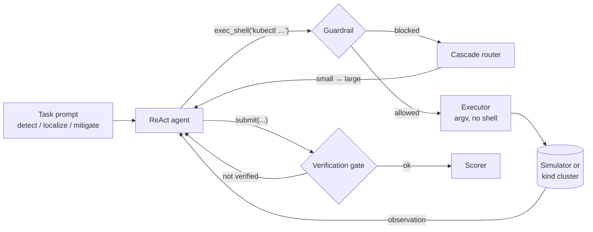

# OpsPilot

**An LLM agent that handles the first response to a Kubernetes incident.** It detects that something is broken, finds the root-cause service and applies a minimal fix. Every command it issues passes through a safety guardrail, and a cost-aware cascade routes steps between a small and a large *free-tier* model.

Evaluation follows the method of Microsoft's [AIOpsLab](https://github.com/microsoft/AIOpsLab): inject a fault, let the agent work, then score the outcome automatically. It runs on a deterministic simulator and on a real [kind](https://kind.sigs.k8s.io/) cluster.

## Results

Simulator, 6 fault scenarios × 3 task types = 16 episodes. Models: `openai/gpt-oss-20b` (small) and `openai/gpt-oss-120b` (large), both on the Groq free tier.

| Config | Overall | Detection | Localization | Mitigation | Avg steps | Tokens / episode | Large-model token share | Guardrail blocks |
|---|---|---|---|---|---|---|---|---|
| `cascade` (OpsPilot) | **15/16 (94%)** | 6/6 | 5/5 | 4/5 | 7.8 | 12.4k | 36% | 3 |
| `cascade-noverify` (gates off) | 15/16 (94%) | 6/6 | 5/5 | 4/5 | 6.5 | 10.1k | 39% | 4 |
| `large` only (120b) | 16/16 (100%) | 6/6 | 5/5 | 5/5 | 7.6 | 14.6k | 100% | 0 |
| `small` only (20b) | 15/16 (94%)* | 6/6 | 5/5 | 4/5 | 7.9 | 12.5k | 0% | 6 |
| `oracle` (scripted expert, real **kind** cluster) | 16/16 | 6/6 | 5/5 | 5/5 | 3.6 | n/a | n/a | 0 |

\*`small`: on the first pass, 5 episodes died on Groq errors (free-tier 429s, `tool_use_failed`). They were re-run with resume; the score counts only completed runs.

**Takeaways**
- The cascade reaches 94% against the large model's 100%, using about 4.5k large-model tokens per episode instead of 14.6k: **69% fewer large-model tokens**.
- Honest result: on these 16 episodes, `small` alone *also* reaches 94%. It got there only after 5 provider errors were re-run, the first-pass failures the cascade's escalation is designed to absorb. The cascade and small-only both missed `target_port` mitigation, which `large` solved. The benchmark is too easy to separate them on accuracy. Harder, multi-fault scenarios are the next step.
- Also on these 16 episodes, the verification gates did **not** change accuracy (94% with and without), and they cost about 23% more tokens. Showing their benefit needs harder scenarios too.

- The small model handled 64% of all tokens. It escalated to the large model in 7 of 16 episodes, triggered by a blocked unsafe command, a repeated command or a format error.
- The scripted expert passing 16/16 on a real cluster shows that every fault really breaks Kubernetes and that the scorer recognises a correct fix.
- The only failure: on `target_port` mitigation, the large model found the broken `geo` Service but submitted without patching it. The verification gate flagged that endpoints were still wrong, but the model submitted again. The trace is `results/main/traces/cascade__target_port-mitigation.json`.
- `small` and `large` ran under a second free-tier key in `results/main-k2/`, and the other configs in `results/main/`. Each folder has a `summary.md` and a `report.html` with per-step traces.

## How it works



| Component | What it does |
|---|---|
| **Guardrail** ([guardrails.py](src/opspilot/guardrails.py)) | Allows only `kubectl`, optionally piped into `grep/head/tail/wc/sort/uniq`. Those filters run in Python with no shell, so `;`, `&&`, `$( )`, `>` and `curl` cannot run. Read-only tasks block every write. Writes must name the app namespace and a single object. `--all`, scale-to-zero, `exec`, `drain`, `apply` and deleting anything except a pod are always blocked. |
| **Cascade router** ([router.py](src/opspilot/router.py)) | Starts on the small model and escalates to the large one when it sees a sign of trouble: a format error, a blocked action, a repeated command, a submit with no fix applied, or a step budget running out. The idea follows FrugalGPT and RouteLLM, with no extra model or training needed. |
| **Verification gates** ([runner.py](src/opspilot/runner.py)) | Mitigation: before closing, OpsPilot itself checks that pods are Ready and endpoints are populated. Detection and localization: if the agent never checked deployments, endpoints or logs, it is told which checks are missing. This catches the "dashboard looks green" mistake. |
| **Simulator** ([sim/](src/opspilot/sim/)) | A 14-service hotel-reservation app (8 microservices + 6 MongoDBs) modelled on DeathStarBench. Pods, endpoints, events and logs are derived from the desired state. It supports `get/describe/logs/patch/set/rollout/scale/delete`. Sub-second, deterministic, CI-friendly. |
| **Real cluster** ([live.py](src/opspilot/live.py)) | The same topology on kind, built from busybox services that really call their dependencies, so a broken service makes its callers fail too. Faults are injected with ordinary `kubectl` commands, the same scenario file as the simulator. |
| **AIOpsLab adapter** ([integrations/aiopslab.py](src/opspilot/integrations/aiopslab.py)) | Plugs OpsPilot into the official AIOpsLab benchmark. Unsafe or malformed actions are retried locally and never reach the benchmark cluster. |

### Fault scenarios

| Scenario | Injected fault | Root cause |
|---|---|---|
| `scale_zero` | `profile` scaled to 0 replicas | profile |
| `target_port` | `geo` Service `targetPort` → 9999 | geo |
| `bad_image` | `rate` image → non-existent tag | rate |
| `node_selector` | `reservation` pinned to a missing node | reservation |
| `missing_env` | `DB_URL` removed from `user` | user |
| `healthy` | none (false-positive check) | n/a |

## Quickstart

Free tier only. Get a key at <https://console.groq.com/keys>.

```bash
git clone <this repo> && cd opspilot
uv sync
cp .env.example .env          # add GROQ_API_KEY
make test                     # 76 tests, no key needed
make oracle                   # scripted expert, checks the scorer, no key needed
make demo                     # watch the agent fix a broken Service
uv run opspilot bench --configs cascade --run-id mine
uv run opspilot report mine   # results/mine/report.html
```

To run against a real Kubernetes cluster (needs Docker and kind):

```bash
make kind-up
uv run opspilot bench --backend kind --configs oracle --run-id kind-oracle
make bench-kind
make kind-down
```

Other commands: `opspilot scenarios`, `opspilot models`, `opspilot shell` (drive the simulator yourself), `opspilot manifest`, `opspilot diagnose` (read-only triage of any live cluster).

## Limitations

- The simulator models the kubectl subset agents actually use, not all of Kubernetes. The kind app uses slim busybox services, not the full DeathStarBench images, so it fits on an 8 GB laptop.
- There are 16 episodes. Each result is a single run, because free-tier quotas rule out repeated seeds.
- Escalation never reverts within an episode. A learned router could make finer-grained decisions.
- The full AIOpsLab suite (metrics, traces, ~50 problems) needs a larger machine. The adapter is included but has not been benchmarked here.

## Tech

Python 3.11, httpx, Groq (OpenAI-compatible API, with Ollama as a local fallback), kind, kubectl, Docker, pytest, ruff, and GitHub Actions (unit tests, kind end-to-end, agent benchmark, Docker build). Interview notes are in [docs/INTERVIEW_NOTES.md](docs/INTERVIEW_NOTES.md).

MIT License.
